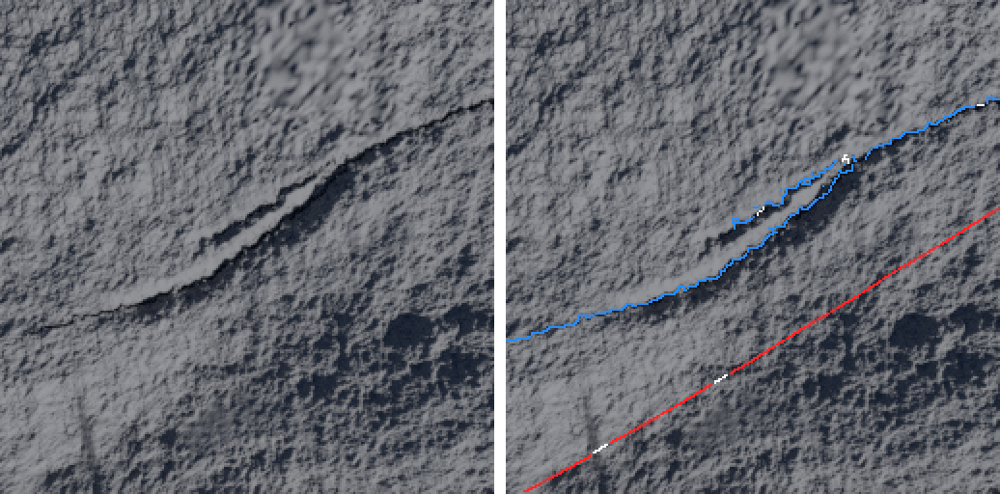
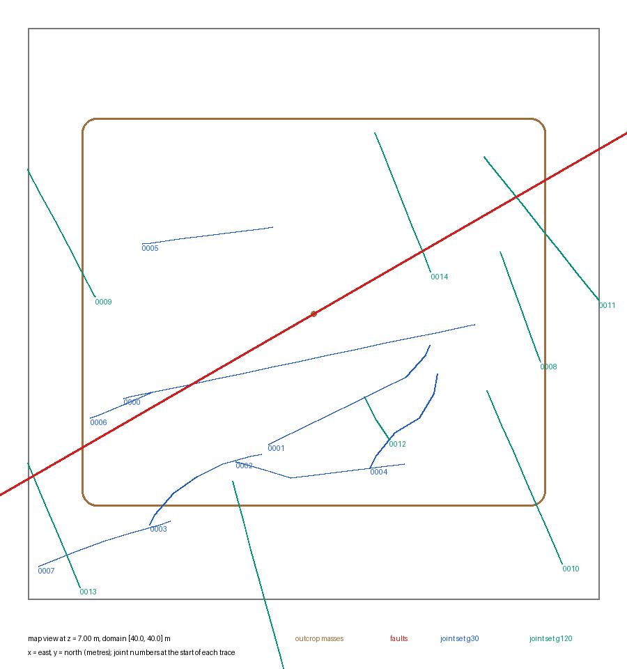

# Controllable outcrop generator

Generates images of rock outcrops with open fractures, plus a label for every fracture trace in each image.

You choose the rock (shape, layers, roughness), the fractures and faults (number, direction, opening, position), the
camera and the sun. The labels are computed from the 3-D model, not drawn by hand.



*Rendered image (left) and its labels (right): joints blue, a fault red, unclear (U) segments white. Unclear segments are
visible parts of a trace that the brightness check does not confirm (see [Output format](#output-format)).*

| To | See |
|---|---|
| try it once (about 16 min, CPU only) | [Quick start](#quick-start-the-end-to-end-example) |
| design your own outcrops, fractures and faults | [Generating your own outcrops](#generating-your-own-outcrops) |
| use the images and labels | [Output format](#output-format) |
| reproduce the paper | [Reproducing the paper](#reproducing-the-paper) |

Pipeline: rock body and fracture network → cameras → fractures cut into the rock → Blender rendering → labels projected
from the 3-D model and checked. Generator of the paper on synthetic fracture images.

## Requirements

**Tested platform.** Windows 11 Pro, AMD Ryzen 7 9800X3D (8 cores), 64 GB RAM, NVIDIA GeForce RTX 5090 (32 GB). The code
was developed and tested on Windows only; parts of it measure memory through Windows system calls, and other platforms
have not been tested.

**Hardware.**

| Run | CPU / GPU | Memory | Time | Disk |
|---|---|---|---|---|
| End-to-end example (256 px, 32 samples, CPU rendering) | any 64-bit CPU | 8 GB | about 16 min | 0.8 GB |
| One paper frame (1024 px, 4096 samples, GPU rendering) | NVIDIA GPU with OptiX recommended | 16-32 GB (largest measured peak 28.1 GB) | 5-25 min | 0.5-1.7 GB |
| One new scene (host rock, joints, cavity inputs) | CPU | 2-6 GB | standalone outcrop about 10 min; flat outcrop about 17 min, about 1 h with a fault | 0.2-1 GB |

The peak memory of a frame grows with the number of cut faces: in the paper's 1024 px frames the largest peaks were 19.6 GB
at 10.9 million faces and 28.1 GB at 15.5 million faces. Without an NVIDIA GPU, render on the CPU with `--device CPU`, which
is much slower at 4096 samples.

**Software.**

* Blender 4.5 LTS (tested with 4.5.14), used in background mode for Cycles rendering;
* two conda environments (Python 3.12 and 3.11; the exact package lists are in `environment/`):
  * *geometry*: NumPy, OpenEXR, trimesh, Pillow and manifold3d 3.5.4 (scene generation, cavity construction,
    refinement, rendering server);
  * *labels*: NumPy, SciPy, Shapely, NetworkX, Pillow (frame driver, refinement levels, trace labels);
* Git (to clone the repository).

The two environments are the ones that produced the paper. `environment/geometry.yml` and `environment/labels.yml` were
also used to build two new environments on the test machine (conda 25.5): `python -m fracgen check` reported them ready,
and the end-to-end example ran in them in 18 minutes with results bit-identical to the reference (without the optional
C++ extension). A single environment holding the union of both package lists should also work but has not been tested.

## Installation

All commands in this README are one line each and are typed in a Windows terminal (Anaconda Prompt or PowerShell).

```bash
git clone https://github.com/GANjj01/controllable-outcrop-generator.git
cd controllable-outcrop-generator
conda env create -f environment/geometry.yml
conda env create -f environment/labels.yml
conda activate fracgen-labels
```

Run every `python -m fracgen` command from the repository root (the folder that holds this README) with one of the two
environments active, as in the last line above; each command starts the environment it needs by itself, using the paths
in the machine configuration below. `conda env list` prints where the two environments were installed.

`environment/geometry.conda-explicit.txt` and `environment/labels.conda-explicit.txt` are the explicit conda package
lists of the two environments that produced the paper (`conda create --name NAME --file ...`), and
`environment/*.pip-freeze.txt` their pip packages; they include packages the generator does not use.
`environment/tested_versions.json` lists the versions the generator imports. manifold3d is installed from PyPI as listed
in `environment/geometry.yml`.

Install Blender 4.5 LTS from <https://www.blender.org/download/lts/4-5/>.

*Optional:* `tools/build_native_geometry.py` compiles a small C++ extension (`_outcrop_exact`, exact geometric
predicates of the geological model) with the Zig C++ compiler and the Boost headers. Without it the same predicates run
in Python: the example scene is then generated in about 11 instead of 8 minutes and its arrays are bit-identical to those
generated with the extension.

Then copy the machine configuration template and fill in the paths:

```bash
copy inputs\runconfig_local.example.json inputs\runconfig_local.json
```

```json
{
 "schema": "frgb-runconfig-1",
 "base": "runconfig_default.json",
 "tools": {
  "python.geometry": "C:/Users/me/miniforge3/envs/fracgen-geometry/python.exe",
  "python.labels": "C:/Users/me/miniforge3/envs/fracgen-labels/python.exe",
  "env.geometry_dir": "C:/Users/me/miniforge3/envs/fracgen-geometry",
  "env.labels_dir": "C:/Users/me/miniforge3/envs/fracgen-labels",
  "blender": "C:/Program Files/Blender Foundation/Blender 4.5/blender.exe"
 }
}
```

Every path the code reads is looked up by name in this configuration (`frgb/runconfig.py`); nothing else on the machine
is used. Check the installation with

```bash
python -m fracgen check
```

which lists the tools and inputs the generator needs, then the packages of the two environments and Blender, each with `ok`
or `MISSING` (`FAILED` for Blender), and ends with `ready` or with the number of problems.

## Quick start: the end-to-end example

```bash
python -m fracgen example --out C:/fg/example
```

Use a short output directory: intermediate files reach about 130 characters below it, and Windows limits paths to 260
characters unless long paths are enabled.

The example goes from a configuration file to the 3-D scene, the camera plan, one cut, rendered and labelled frame, and
its checks. It uses one standalone outcrop of the paper's design (`examples/minimal/scene_config.json`, seed 26130000,
relief amplitude a = 2.067, spectral slope H = 0.957) with the paper's mid-range fracture parameters (mean opening
5.5 cm, depth 0.175 m, opening variation 0.225, wall roughness 2.06 mm) and renders camera slot 1 at 256 x 256 px with
32 samples on the CPU. On the tested machine it takes about 16 minutes and 0.8 GB of disk:

| Step | Time | Peak memory |
|---|---|---|
| scene generation (host, relief, joints, exact fields, cavity inputs) | 9.6 min | about 3 GB |
| camera plan | 0.3 min | below 2 GB |
| refinement, field normals, cavity construction (cut, repair, provenance check, export) and display normals | 3.8 min | 3.7 GB |
| rendering (CPU, 8 threads, 256 x 256 px, 32 samples) | 0.2 min | below 2 GB |
| trace labels and checks | 2.0 min | 4.2 GB |

At the end the command compares the result with `examples/minimal/expected.json` and prints one line per item:

```
checks overall                       ok     got PASS                   expected PASS
scene surface_vertices               ok     got 84575                  expected 84575
cameras in plan                      ok     got 4                      expected 4
render rock fraction                 ok     got 0.7410888671875        expected 0.7410888671875
labels positive_pixels               ok     got 115                    expected 115
labels occluded_pixels               ok     got 387                    expected 387
labels visible length (px)           ok     got 281.9674928422272      expected 281.9674928422272
...
bitwise identical to the reference run: {'scene': True, 'render': True, 'labels': True}
EXAMPLE PASS
```

The item checks allow small numerical differences between machines (different CPUs can round floating-point sums
differently); the last line reports whether the arrays are bit-for-bit identical to the reference run. On the tested
machine, the example run with this repository and the same run with the internal code that produced the paper give
bit-identical scene, image and label arrays. The scene agrees with the paper's scene of the same seed to within
2e-15 m in every vertex coordinate (the paper's scene was generated with an earlier revision that rounds differently in
the last bit; the lithology names were later replaced by neutral labels), and the camera plan is identical to the paper's
plan for this scene.

Outputs of the example (under the output directory):

```
scene/                       host rock, joint network, cavity inputs (scene/, net/), camera plan (plan.json)
frames/example/q0/render/    frame.png, frame.npz (RGB, depth, material index, region mask)
frames/example/q0/trace_labels/   label layers (*.npy) and report.json
frames/example/q0/labels.npz      target, U line, valid mask, source type in one file
frames/example/checks.json   per-frame checks
frames/example/frame.json    summary of the frame (parameters, timings, label statistics, file paths)
example_check.json           comparison with examples/minimal/expected.json
```

## Generating your own outcrops

A run has four steps. Once the machine configuration is in place, each command prints its options with `-h`.

```bash
python -m fracgen preview  my_config.json --seed 7 --out my_scene/preview         # < 1 s: map of rock, joints and faults
python -m fracgen scene    my_config.json --seed 7 --out my_scene --outcrop flat   # 10-60 min: 3-D scene
python -m fracgen cameras  my_scene                                                 # 1 min: camera plan
python -m fracgen frame    my_scene --out my_frames --camera 0 --width-m 0.04 --sun-azimuth 135 --sun-elevation 35
```

### 1. Scene configuration

Start from `configs/scenes/standalone_outcrop.json` (an isolated rock body, as in the paper's standalone outcrops),
`configs/scenes/flat_outcrop.json` (a low tiled slab, as in the paper's flat outcrops) or
`configs/scenes/flat_outcrop_with_fault.json` (the flat slab with one user-placed fault). The fields that shape the
outcrop and its fractures are:

```json
{
 "schema_version": 1,
 "seed": 20261109,
 "geometry": {
  "family": "group_a",
  "exposure": "bluff",
  "tile_m": 32.0,
  "layer_count": 4,
  "lithologies": ["group_a_01", "group_a_02", "group_a_04"],
  "unconformity": false,
  "shape": {"width_m": 35.9, "depth_m": 35.9, "height_m": 2.5, "mass_count": 1},
  "stratigraphy": {"wavelengths_m": [68.0, 52.0]},
  "fracture_count": 16,
  "fracture_network": {
   "direction_groups": [
    {"id": "g30",  "count": 8, "mean_direction_deg": 30.0,  "direction_std_deg": 10.0},
    {"id": "g120", "count": 8, "mean_direction_deg": 120.0, "direction_std_deg": 10.0}
   ],
   "extrusion_direction": [0.0, 0.75, 1.0]
  },
  "fault_count": 0,
  "faults": [
   {"id": "fault-user-1",
    "plane": {"strike_deg": 60.0, "dip_deg": 70.0, "point_m": [20.0, 20.0, 7.0]},
    "motion": {"kind": "throw", "throw_down_m": 0.8, "pure_dip_slip": true},
    "moving_side": "positive"}
  ]
 },
 "scene": {"scanned_preset": "river_valley"}
}
```

Coordinates are metres in an east-north-up frame (x east, y north, z up); the model domain is the square tile plus a
margin (40 m x 40 m for `tile_m` = 32). Angles are azimuths in degrees, clockwise from north.

| Field | Meaning |
|---|---|
| `seed` | the random stream of the whole scene; overridden by `--seed` |
| `geometry.exposure` | `bluff` is the outcrop type supported by the cavity and label chain |
| `geometry.shape` | outcrop body: `width_m`, `depth_m`, `height_m`, `azimuth_deg` (long axis), `centre_xy_m`, `mass_count` (number of rounded masses), `rounding_fraction`, `base_depth_m`, `blend_m`; omitted values are drawn from the seed. With `--outcrop flat` the body is set exactly to width x depth x height |
| `geometry.layer_count`, `lithologies`, `stratigraphy`, `unconformity` | layered rock body. Lithology names are labels only: all rock is rendered with the same material |
| `geometry.fracture_count` | number of joints (0-20) |
| `geometry.fracture_network.direction_groups` | joint sets: number of joints, mean strike and its standard deviation; the counts add up to `fracture_count` |
| `geometry.fracture_network.extrusion_direction` | direction along which the joint traces are extruded into surfaces (sets the joint dip; it must not be horizontal) |
| `geometry.fault_count` | number of faults placed at random from the seed (0-2 are typical); ignored when `geometry.faults` is given |
| `geometry.faults` | faults placed by the user (below) |
| `scene.scanned_preset` | kept from the paper's configuration; it is a name only and does not change the geometry |

The scene command also takes the two background-relief parameters `--amplitude` (a, the paper samples 0.85-2.55) and
`--hurst` (H, the spectral slope, 0.50-1.25); (a, H) = (1, 0.718) gives the calibrated relief spectrum.

### 2. Placing fractures and faults

**Faults** can be placed exactly. Each entry of `geometry.faults` is one planar fault:

* `plane.point_m`: any point on the fault plane (x, y, z in metres); `plane.strike_deg`: strike azimuth (right-hand
  rule: the plane dips to the right of the strike direction); `plane.dip_deg`: dip, 0-90 degrees;
* `motion`: `{"kind": "throw", "throw_down_m": T, "pure_dip_slip": true}` moves one side down the dip by the vertical
  throw T (the paper's random faults use 0.6-3.0 m);
* `moving_side`: `positive` or `negative`, the side of the plane (relative to its normal) that moves;
* `id`: a unique name that does **not** have the form `fault-<number>` (those names are used by the random faults).

When `geometry.faults` is given, no fault is placed at random (`fault_count` then equals the number of listed faults),
and the listed faults are applied in list order after the joints. The label program refuses a frame in which a joint is
displaced by two or more faults, so keep faults apart where they would cut the same joint.

The paper's scenes contain zero or one random fault. User-placed faults use the same construction; the flat outcrop of
`configs/scenes/flat_outcrop_with_fault.json` was run through the whole chain (scene generation 52 min, camera plan,
cut, rendering and labels at 256 px): its frame from camera slot 0 has 289 px of visible fault trace and 598 px of
visible joint traces, and the cavity rebuild of the label program verified.

The figure at the top of this page is that frame (labels: joints blue, the fault red, unclear segments white).

**Joints** are grown by the generator: each joint starts from a seed point drawn from the scene seed and grows step by
step along its set's direction, attracted by nearby joints and stopping at intersections. Their number, sets, strikes
and dip are set in the configuration; their positions follow from the seed. To obtain a layout you want, change the seed
and look at the preview:

```bash
python -m fracgen preview configs/scenes/flat_outcrop_with_fault.json --seed 20261109 --out preview
```

`preview/preview.png` is a map at a chosen height (`--z`, default 1 m above the ground) of the tile, the outcrop masses
(brown), the joint traces (one colour per set, numbered) and the fault strike lines (red); `preview/preview.json` lists
the same objects as numbers (joint trace points, fault planes, outcrop masses). The preview runs the same sampling as the
scene command, so the scene generated with that seed has exactly these joints and faults.



### 3. Cameras

`python -m fracgen cameras my_scene` draws 1024 px cameras aimed at exposed fracture segments, in cells of pixel size
(fine 4-11 mm/px; on flat outcrops also coarse 11-32 mm/px) and view angle (frontal, oblique). A camera is kept only if
the frame is filled by rock, the target fracture is visible over at least 256 px and the depth check passes. `plan.json`
lists each camera with its `shot` (position, target, focal length), pixel size and checks. The frame command takes a
camera *slot*: 0-3 are fine frontal, fine oblique and the second draw of each on standalone outcrops, and the four cells
on flat outcrops. To place a camera yourself (for example a close-up), give `--position`, `--target` and `--focal-mm` to
the frame command; the pixel size at the target is distance x 36 / focal length / image width.

### 4. Frames

```bash
python -m fracgen frame my_scene --out my_frames --camera 1 --width-m 0.055 --variation 0.225 --depth-m 0.175 --roughness-m 0.0020625 --sun-azimuth 135 --sun-elevation 35 --resolution 1024 --spp 4096 --device OPTIX
```

| Option | Meaning (paper range) |
|---|---|
| `--width-m` | mean fracture opening w (0.03-0.08 m) |
| `--variation` | relative variation of the opening along the trace (0-0.45) |
| `--depth-m` | cavity depth d (0.10-0.25 m) |
| `--roughness-m` | wall roughness (0-0.075 w; default 0.0375 w) |
| `--sun-azimuth`, `--sun-elevation` | sun direction in degrees (elevation 15-70) |
| `--sky overcast` | overcast sky instead of sun (default `sun`) |
| `--render-seed` | Cycles seed of the rendering (default 0; repeats of the same frame use 1, 2, ...) |
| `--position E N U`, `--target E N U`, `--focal-mm F` | your own camera (metres, east-north-up; film back 36 x 36 mm); it replaces the plan camera of `--camera` |
| `--resolution`, `--spp`, `--device` | image size, Cycles samples, `OPTIX`, `CUDA` or `CPU` |

The program enforces limits on the four fracture parameters. The cavity builder (`PARAMETER_BOUNDS` in
`frgb/network_profiles.py`) accepts a mean opening of 0.03-0.08 m, a variation of 0-0.45, a depth of 0.10-0.25 m and a wall
roughness of 0-0.006 m; a value outside these ranges is not clipped but refused with an error. The first three are the ranges
of the paper; for the roughness the paper stays at or below 0.075 w, which is 0.006 m at the largest opening. The depth is
given in metres and does not depend on the opening: the ratio depth / w is 1.8-4.5 at the default w = 0.055 m and 1.25-8.3
over the whole range of w.

A frame stops before rendering when its geometry is rejected (for example a fracture parameter outside the ranges above): the
command ends with `frame stopped before rendering` and the reason `geometry rejected`, and the error of the cavity builder is
kept in `q0/geometry.json` and `q0/logs/build.log` of the frame folder. The parameters are checked when the cavities are
built, after the rock surface has been refined, so the stop comes some minutes into the run.

## Output format

### Rendered frame (`render/frame.npz`, `render/frame.png`)

| Array | Type | Meaning |
|---|---|---|
| `rgb` | float32, H x W x 3 | linear scene radiance from Cycles (Combined pass) |
| `depth` | float32, H x W | Cycles depth pass in metres |
| `index` | int32, H x W | material pass index: rock codes >= 1, ground 900, sky 0 |
| `mask` | uint8, H x W | 0 sky, 1 rock, 2 ground, 255 undetermined |

`frame.png` is the 8-bit sRGB image: `rgb` times the exposure factor `exposure_k` (in `render/render_point.json`)
times the white-balance gains of the light, encoded with the sRGB transfer function.

### Label layers (`trace_labels/*.npy`, H x W)

| Layer | Type | Meaning |
|---|---|---|
| `target.npy` | bool | positive pixels: the visible fracture centreline, skeletonised to 1 px, outside every marked pixel |
| `valid.npy` | bool | rock pixels without any mark: the pixels to be scored |
| `ignore_reason.npy` | uint8 | mark bits (below); a pixel is marked when any bit is set |
| `u_line.npy` | bool | visible centreline judged unclear (U) by the brightness check (below) |
| `occluded_line.npy` | bool | centreline hidden behind rock |
| `source_type.npy` | uint8 | origin of each centreline pixel: 0 none, 1 joint, 2 fault, 3 crossing |
| `opening_class.npy` | uint8 | cavity pixels outside the 2 px band of a visible centreline: 1 mouth of a fracture whose centreline is visible, 2 side-wall opening |
| `band_win.npy`, `ring_win.npy` | int32 | window ids of the contrast test (band along the trace, ring around it); -1 elsewhere |
| `report.json` | | per-frame report: visible length, per-path lengths, U windows, refinement and the gate values used by the checks |

**The unclear (U) layer.** The brightness check takes one window per 8 px of arc length along the visible centreline and
compares the mean brightness of the pixels inside the fracture (the in-fracture band) with that of the adjacent pixels of the
uncut rock surface (the ring), in grey levels of the 8-bit image with Rec. 709 weights. A window is unclear for one of two
reasons:

* *low brightness difference*: the two means differ by less than 2 grey levels;
* *insufficient sampling*: the ring of adjacent rock has fewer than 4 pixels or the in-fracture band is empty, so the two
  cannot be compared.

`u_line.npy` holds the centreline pixels of the unclear windows; they are not in `target.npy`. `windows.json` in the same folder
lists every window with its pixel counts (`band_pixels`, `ring_pixels`), its brightness difference (`contrast`) and the result
(`u`), so the two causes can be told apart. In the paper's 50 multi-illumination aerial frames, 3.1-15.9 % of the windows of a
frame are unclear, and 610 of the 1025 unclear windows (59.5 %) are so because of insufficient sampling.

The paper calls `target` the final centreline, the unclear layer the brightness-unconfirmed (unconfirmed) segments and
`occluded_line` the occluded segments, and it writes aperture for the opening of a fracture.

Mark bits of `ignore_reason`:

| Bit | Value | Meaning |
|---|---|---|
| 0 | 1 | within 2 px of an unclear (U) centreline |
| 1 | 2 | transition between a visible and an occluded part of a trace |
| 2 | 4 | unresolved projection: trace samples whose image position or visibility could not be determined |
| 3 | 8 | sky and ground, and rock within 3 px of the ground |
| 4 | 16 | rock in the rendered image that the label program's own rasterisation of the cut mesh does not confirm |
| 5 | 32 | occluded by the groove of its own joint |
| 6 | 64 | occluded by the trench or scarp of its own fault |
| 7 | 128 | label-render mismatch band |

`labels.npz` repeats `target`, `u` (= `u_line`), `valid` and, when present, `ttype` (= `source_type`).

### Building a training mask

```python
import numpy as np

d = 'my_frames/frame/q0/trace_labels/'
target = np.load(d + 'target.npy')          # positives
valid = np.load(d + 'valid.npy')            # pixels that enter the loss
marks = np.load(d + 'ignore_reason.npy')

positive = target & valid
negative = valid & ~target
ignore = ~valid                             # sky, ground and every marked pixel
# a tolerance band around the centreline, if the loss needs one:
from scipy import ndimage as ndi
near = ndi.distance_transform_edt(~target) <= 2
negative_far = negative & ~near
# select marks by bit, e.g. keep only the unclear-trace mark:
unclear = (marks & 1) > 0
```

## Checks

`checks.json` holds the checks applied to every aerial frame of the paper; items 1 to 5 are the five label acceptance
criteria of the paper:

| Item | Passes when |
|---|---|
| `1_gates` | the label program finished and none of its stop gates fired (centre deviation from the cavity mid-surface, coverage inside the own cavity, contradictory labels) |
| `2_jumps` | no centreline pixel jumped to another branch during the position refinement |
| `3_displacement` | at most 0.5 % of the visible trace moved by more than 2 px during refinement |
| `4_breaks` | the refinement adds at most max(1, floor(0.005 x visible length / 6)) breaks to the trace runs |
| `5_capped` | at most 2 % of the in-frame trace hit the refinement step limit and was returned to its first position |
| `field_normal_residual_m` | the exact surface normals re-evaluate the refined vertices to within 1e-6 m |

The chain also stops on geometric checks of its own: the refined surface must stay within 0.5 px of the exact surface in
every zone and in the whole frame, the cut must keep the provenance of every host face, and the label program
rebuilds the cavity walls and requires them to match the construction to 1e-6 m. `report.json` keeps the measured values.

The `status` field of `report.json` reads `TRACE_LABEL_CANDIDATE_NOT_QUALIFIED` for every frame, including the paper's;
it is a fixed tag of the label rule and carries no information about the frame. Use `checks.json`.

## Reproducing the paper

See [`reproduce/paper1/README.md`](reproduce/paper1/README.md). In short:

* `python reproduce/paper1/main_text.py` recomputes the numbers of the main text (abstract, Sections 4 to 7, Table 2 and
  the captions of Figs 4 to 6: 62 statements with 215 printed values) from the records in `reproduce/paper1/records/` and
  compares each with the value printed in the manuscript, listed in `reproduce/paper1/main_text_values.json` (a few
  seconds, standard library and NumPy only); two rows of Table 2 that come from single cases are not covered, see
  `reproduce/paper1/README.md`;
* `python reproduce/paper1/tables.py` does the same for the tables of the supplement (S1-S3): it aggregates
  the per-frame records again and checks every value against the stored summaries;
* `reproduce/paper1/figures/` holds the scripts that draw Figs 4, 5 and 6 from the records (they need Matplotlib);
* `reproduce/paper1/analysis/` holds the scripts that produced the records of Sections 4 and 5 from generated frames and
  from the two public datasets of real outcrops, GeoCrack and FraXet. No file of either dataset is in this repository:
  the records hold statistics only, and `reproduce/paper1/analysis/README_real_data.md` gives the references, licences and
  DOIs;
* `reproduce/paper1/frames.csv` lists the 115 labelled frames of the paper with their scene seed, relief parameters,
  outcrop type, camera shot, fracture parameters, light and render settings, and with the options of `fracgen scene`
  and `fracgen frame` that generate each of them again; `reproduce/paper1/sweeps.csv` lists in the same way the 473
  frames of the two controlled experiments of Section 5 (view-angle sweep and illumination sweep);
* the end-to-end example above repeats one scene of the paper from its seed, with the camera of the standalone-outcrop
  viewpoint of the illumination sweep.

## Repository layout

```
fracgen/          command line: check, preview, scene, cameras, frame, example
frgb/             library: scene design and relief, cavity panels and cutters, fault charts, rasterisation, trace labels
frgb/chain/       Blender worker and client, exact host surface, refinement, source rasters
multiscene/       per-scene tools: camera plans, zone refinement, field normals and display, driver of one frame
multiscene/host/  host generation on the normal-offset route (scene phases spec, generate, fields, wall)
multiscene/cavity_template/   cavity builder copied into every scene (prepare, build, repair, provenance check, export)
multiscene/scene_sets/        effective scene configuration and camera-plan entry points for flat and standalone outcrops
labels/           label program (one frame), cavity rebuild, fault support, label-render mismatch and occlusion rules
outcrop/          geological model: layered bodies, joint networks, faults, outcrop surfaces, exact fields
inputs/           run configuration and the small calibration inputs (relief spectrum, sky table, exposure limits)
configs/scenes/   scene configurations
examples/minimal/ end-to-end example and its expected results
reproduce/paper1/ main_text.py and tables.py (recompute the paper's numbers from the records), frames.csv and sweeps.csv (the
                  paper's frames and the options that generate them)
reproduce/paper1/records/     per-frame and per-case records; round3/ holds the records behind Sections 4 and 5
reproduce/paper1/analysis/    scripts that produced the records of Sections 4 and 5 from frames and from the public real datasets
reproduce/paper1/figures/     scripts that draw Figs 4-6 of the paper from the records
environment/      conda environment files
docs/             provenance of the released code, images of this page
tests/            repository checks that need no rendering
```

## Citation

If you use this generator, please cite the paper (reference to be added on publication) and this repository
(`CITATION.cff`).

## License

MIT License, see [`LICENSE`](LICENSE).
